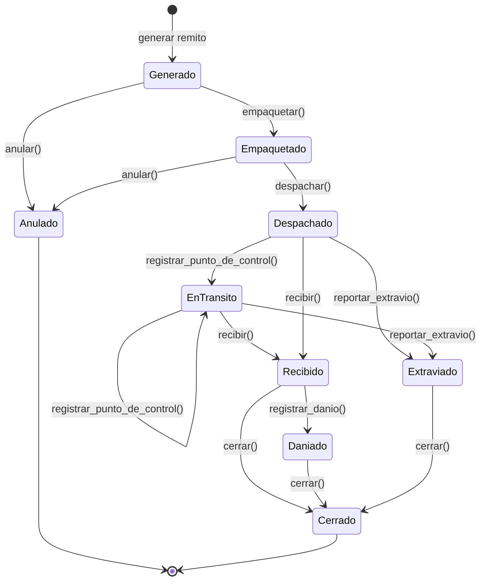

# Ciclo de vida del remito

El remito acompaña a un ejemplar en cada traslado entre sedes. La consigna pide "empaquetar, despachar y recibir ejemplares, asignando un remito y permitiendo la trazabilidad del mismo a lo largo del trayecto (estados)". También aclara que este ciclo de vida "será evaluado críticamente en el modelo". Por eso cada estado está justificado y cada transición queda registrada.

## Diagrama de estados

## Estados

| Estado | Significado | Efecto sobre el ejemplar |
|---|---|---|
| **Generado** | Se emitió el remito para un préstamo interbibliotecario (o para el retorno), pero el ejemplar todavía no se preparó. | Queda comprometido para el préstamo. |
| **Empaquetado** | El ejemplar fue embalado en la sede de origen y espera que lo retiren. | Sin cambios. |
| **Despachado** | El paquete salió de la sede de origen. | Pasa a `EN_TRANSITO`. |
| **EnTransito** | El paquete pasó por al menos un punto de control del trayecto. Es el único estado que admite transiciones a sí mismo: se pueden registrar varios puntos de control, y cada uno queda en el historial. Esto es lo que da trazabilidad "a lo largo del trayecto". | Sigue `EN_TRANSITO`. |
| **Recibido** | La sede de destino recibió el paquete y revisó su estado físico. | En un remito de ida, el préstamo pasa a `LISTO_PARA_RETIRO`. En un remito de retorno, el ejemplar vuelve a `DISPONIBLE` en su sede. |
| **Daniado** | Al recibirlo se constató daño o destrucción. Corresponde al proceso opcional de "revisión de estado de recepción". | El estado físico pasa a `DANIADO` y el ejemplar sale de circulación. |
| **Extraviado** | El paquete no llegó. | El ejemplar pasa a `EXTRAVIADO` y el préstamo asociado se cancela. |
| **Anulado** | Se canceló el envío antes de que saliera de la sede de origen, por ejemplo porque el socio desistió o una de las sedes fue dada de baja. | Vuelve a `DISPONIBLE`. |
| **Cerrado** | El remito quedó archivado. Es el estado final del circuito normal y de los dos desvíos (Daniado y Extraviado). | Sin cambios. |

## Decisiones de diseño

- **¿Por qué se distingue Despachado de EnTransito?** "Despachado" registra la salida de la sede de origen. "EnTransito" registra que el paquete pasó por puntos de control intermedios del recorrido. Los traslados directos pueden ir de Despachado a Recibido sin pasar por EnTransito.
- **¿Por qué hay un estado Anulado?** La consigna prohíbe iniciar envíos desde o hacia una sede dada de baja. Si una sede se da de baja mientras tiene remitos sin despachar, esos remitos tienen que poder cancelarse sin inventar un recibo falso. La anulación solo se permite antes del despacho: una vez que el ejemplar salió, el remito solo puede terminar como recibido o extraviado.
- **Transiciones inválidas.** Cada estado implementa solamente las transiciones que le corresponden. Cualquier otra lanza la excepción de dominio `TransicionRemitoInvalida`, y el remito conserva su estado anterior. La interfaz captura la excepción y le informa el problema al usuario. Esto cumple el criterio de la cátedra de que "las acciones no permitidas deben informar el problema sin cambiar el estado".
- **Persistencia del estado.** Se sigue el esquema de la cátedra: el `Remito` (contexto) mantiene un objeto estado y delega en él cada operación. En la base se guarda el nombre de la clase del estado, y el objeto se reconstruye al cargar el remito.
- **Trazabilidad.** Cada transición válida crea un `MovimientoRemito` con el estado anterior, el estado nuevo, la fecha y hora, y una observación. El trayecto completo se puede consultar en cualquier momento.
