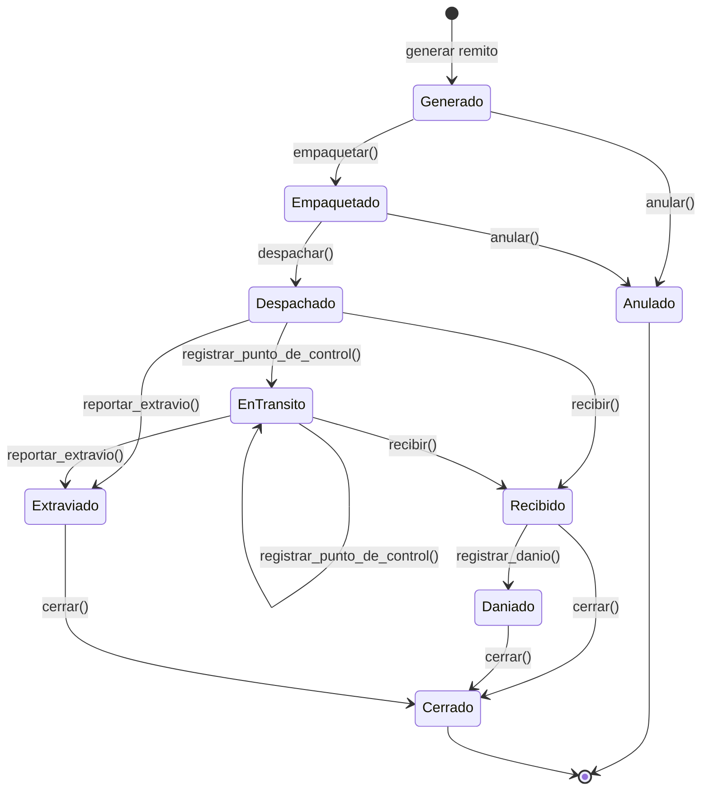

# Ciclo de vida del remito

El remito acompaña a un ejemplar en cada traslado entre sedes. La consigna pide "empaquetar, despachar y recibir ejemplares, asignando un remito y permitiendo la trazabilidad del mismo a lo largo del trayecto (estados)". También aclara que este ciclo de vida "será evaluado críticamente en el modelo". Por eso cada estado está justificado y cada transición queda registrada.

Hay dos tipos de remito:

- **Ida:** lleva el ejemplar desde su sede propietaria (origen del préstamo) hasta la sede donde lo retira el socio (destino). Se genera al solicitar un préstamo interbibliotecario.
- **Retorno:** devuelve el ejemplar a su sede propietaria. Se genera después de la devolución, o cuando el ejemplar llega dañado a destino.

## Diagrama de estados

## Estados y consecuencias

| Estado | Significado | Remito de ida | Remito de retorno |
|---|---|---|---|
| **Generado** | Se emitió el remito, pero el ejemplar todavía no se preparó. | El préstamo está `SOLICITADO` y el ejemplar comprometido. | El ejemplar espera en la sede donde se devolvió. |
| **Empaquetado** | El ejemplar fue embalado en la sede de origen. | Sin cambios. | Sin cambios. |
| **Despachado** | El paquete salió de la sede de origen. Antes de despachar se controla que las dos sedes estén activas. | El préstamo pasa a `EN_ENVIO` y el ejemplar a `EN_TRANSITO`. | El ejemplar pasa a `EN_TRANSITO`. |
| **EnTransito** | El paquete pasó por un punto de control del recorrido. Se pueden registrar varios puntos de control seguidos, y cada uno guarda la ubicación. | Sin cambios. | Sin cambios. |
| **Recibido** | La sede de destino recibió el paquete y registró su estado físico. | El préstamo pasa a `LISTO_PARA_RETIRO`. El remito se cierra cuando el socio retira el ejemplar. | El ejemplar vuelve a `DISPONIBLE` y el remito se cierra en el acto. Si hay reservas pendientes del libro en la sede, el ejemplar se aparta para la más antigua. |
| **Daniado** | Se constató un daño al recibir el paquete, o antes de entregarlo al socio. | El préstamo se cancela y se genera un remito de **retorno** para devolver el ejemplar a su sede. | El ejemplar queda `EN_REPARACION` en su sede, que decide si lo repara o lo da de baja. |
| **Extraviado** | El paquete no llegó a destino. | El préstamo se cancela y el ejemplar pasa a `EXTRAVIADO`. | El ejemplar pasa a `EXTRAVIADO`. |
| **Anulado** | El envío se canceló antes de salir de la sede de origen. **Solo se permite en remitos de ida.** | El préstamo se cancela y el ejemplar vuelve a estar disponible (o se aparta para la siguiente reserva). | No se permite: el ejemplar tiene que volver a su sede. |
| **Cerrado** | El remito terminó su recorrido y todas sus consecuencias ya se aplicaron. | — | — |

En los desvíos (`Daniado` y `Extraviado`) el remito se cierra en la misma operación. Así el historial muestra el incidente y a continuación el cierre, y un remito cerrado nunca queda con tareas pendientes.

## Decisiones de diseño

- **¿Por qué se distingue Despachado de EnTransito?** "Despachado" registra la salida de la sede de origen. "EnTransito" registra el paso por puntos de control intermedios, y es el único estado que admite transiciones a sí mismo. Esto cubre la trazabilidad "a lo largo del trayecto". Un traslado directo puede ir de Despachado a Recibido sin pasar por EnTransito.
- **¿Por qué hay un estado Anulado?** La consigna prohíbe iniciar envíos desde o hacia una sede dada de baja. Si una sede se da de baja con envíos sin despachar, esos remitos tienen que poder cancelarse. Una vez que el ejemplar salió, el remito solo puede terminar recibido o extraviado.
- **¿Qué pasa con un ejemplar que llega dañado al préstamo?** No se entrega al socio. El ejemplar vuelve a su sede propietaria con un remito de retorno, porque le pertenece a esa sede y la consigna pide trazabilidad en todo el trayecto. Al llegar queda en reparación, y la sede decide si lo repara ("Finalizar reparación" en el menú de catálogo) o lo da de baja.
- **El daño se revisa en la recepción.** Al recibir, la sede indica el estado físico del ejemplar. Si es "Dañado", el remito pasa por Recibido y Daniado en la misma operación. Si el daño aparece después, al momento de entregar al socio, se puede registrar mientras el préstamo esté listo para retiro. Esto corresponde al proceso opcional "revisión de estado de recepción de ejemplares".

## Implementación (patrón State)

- `biblioteca/patrones/estados_remito.py` define la clase abstracta `EstadoRemito` (con `ABC`) y una clase concreta por estado: `Generado`, `Empaquetado`, `Despachado`, `EnTransito`, `Recibido`, `Daniado`, `Extraviado`, `Anulado` y `Cerrado`. `Despachado` y `EnTransito` heredan de `EnViaje`, que concentra lo que comparten: recibir, registrar un punto de control y reportar extravío.
- `Remito` (`biblioteca/modelos/remito.py`) es el **contexto**: tiene un objeto estado y delega cada acción en él (`remito.despachar(...)` llama a `self._estado.despachar(self, ...)`). Cada estado decide a qué estado se pasa con `remito.cambiar_estado(NuevoEstado(), ...)`, como en el ejemplo de la cátedra.
- **Transiciones inválidas.** La clase base implementa todas las acciones lanzando `TransicionRemitoInvalida`, y cada estado redefine solo las que admite. Cuando se rechaza una acción, el estado y el historial no cambian. La interfaz captura la excepción y le informa el problema al usuario, como pide el criterio de la cátedra ("las acciones no permitidas deben informar el problema sin cambiar el estado").
- **Persistencia.** En la base se guarda el nombre del estado (`nombre_estado`). Al leer un remito, SQLAlchemy llama a un método marcado con `@reconstructor`, que vuelve a crear el objeto estado a partir de ese nombre.
- **Trazabilidad.** Cada cambio de estado agrega un `MovimientoRemito` con el estado anterior, el estado nuevo, la fecha y hora y una observación (por ejemplo, la ubicación de un punto de control o el motivo de una anulación). El menú de remitos muestra el trayecto completo.
- Las consecuencias que necesitan consultar la base las resuelve `ServicioRemitos`: apartar el ejemplar para una reserva y generar el remito de retorno.
