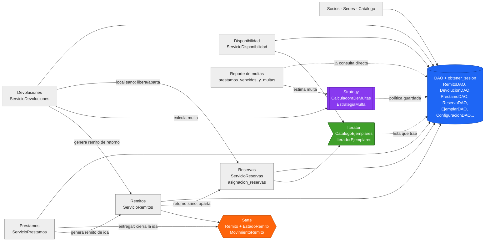
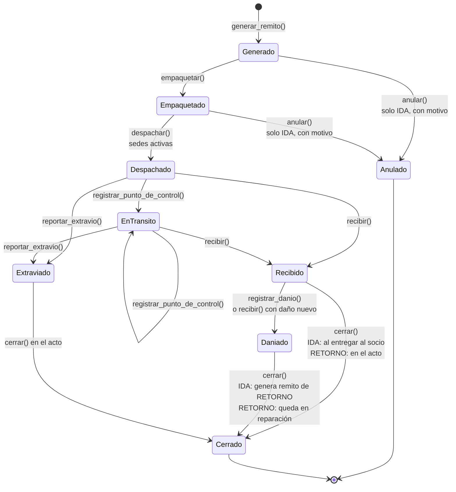

# Guion del video: DAO, Strategy, State e Iterator en la red de bibliotecas

Video animado y abstracto de unos **17 minutos**, calculados con una narración pausada (unas 150 palabras por minuto) y algunos segundos por escena para que se vea la animación. Lo escribí a partir del código del repositorio, no de la descripción del prompt: cada archivo, clase y método que se nombra existe en el código, y los fragmentos se copiaron tal cual. Donde el código no cumple una regla, aparece marcado como **⚠** y la corrección figura como *propuesta*.

## Colores y metáforas fijas (se usan igual en todo el video)

| Patrón | Color | Metáfora | Ícono en pantalla |
|---|---|---|---|
| **DAO** | 🟦 Azul | El depósito con su encargado (el bibliotecario que busca y guarda por vos) | Una puerta de depósito con un encargado con gorra azul |
| **State** | 🟧 Naranja | El semáforo que lleva cada paquete | Una caja con un semáforo pegado arriba |
| **Strategy** | 🟪 Violeta | La caja de reglas intercambiables | Una caja con tarjetas de reglas que se sacan y se ponen |
| **Iterator** | 🟩 Verde | La cinta transportadora (la maestra que pasa lista) | Una cinta que avanza de a un ejemplar por vez |

Los objetos del dominio siempre en gris: **sede** = edificio, **socio** = muñequito, **ejemplar** = libro con una etiqueta de código, **préstamo** = un hilo que une al socio con el ejemplar, **remito** = una hoja pegada a la caja, **devolución** = una flecha de vuelta, **multa** = una moneda.

---

## Escena 1. La ciudad de las bibliotecas (apertura)

**Duración:** 0:45

**Visual:** Vista desde arriba de una ciudad plana, dibujada con formas simples. Tres edificios grises con carteles: "Sede Centro", "Sede Sur", "Sede Norte". Entre ellos aparecen cuatro "servicios de la ciudad", uno por vez y cada uno con su color: un depósito azul debajo de la ciudad (todas las sedes tienen una escalera que baja a él), un camioncito con un semáforo naranja que va por las calles, una caja violeta en el mostrador de cada sede y una cinta verde que recorre los estantes. Al final, los cuatro colores se encienden juntos.

**Narración:**
> Esta es una ciudad de bibliotecas. Cada edificio es una sede. Los socios piden libros, los devuelven, y los libros viajan de una sede a otra.
> Para que todo funcione, la ciudad tiene cuatro servicios.
> Azul: el depósito, con su encargado.
> Naranja: un semáforo que lleva cada paquete.
> Violeta: una caja de reglas para cobrar las multas.
> Verde: una cinta que te pasa los libros de a uno.
> En programación, a estos servicios se los llama "patrones de diseño": recetas probadas para problemas que se repiten.
> Vamos a conocerlos de a uno.

---

# Sección DAO (azul): el depósito y su encargado

## Escena 2. DAO: la metáfora

**Duración:** 0:40

**Visual:** Un socio gris llega al mostrador y pide "el libro de dinosaurios". No pasa al depósito: el encargado azul baja la escalera, busca en estantes que no vemos y vuelve con el libro. Después, el socio devuelve otro libro y el encargado lo guarda. Un cartel en la puerta dice "Solo personal autorizado".

**Narración:**
> Imaginate que vas a la biblioteca. No entrás al depósito a buscar el libro. Se lo pedís al bibliotecario. Él sabe en qué estante está, lo trae, y cuando lo devolvés, lo guarda.
> Vos no necesitás saber cómo está ordenado el depósito.
> Eso es un DAO. La sigla quiere decir "objeto de acceso a datos". Es el encargado que habla con la base de datos por vos.
> La regla de oro es: nadie entra solo al depósito. Siempre se le pide al encargado.

## Escena 3. DAO: el problema que resuelve

**Duración:** 0:40

**Visual:** Versión "sin patrón": muchos socios y empleados entran al depósito al mismo tiempo, cada uno revuelve los estantes a su manera. Los libros quedan tirados. Un letrero rojo parpadea: "¿Y si cambiamos los estantes de lugar?". Todos se quedan quietos con un signo de pregunta.

**Narración:**
> ¿Qué pasaría sin encargado? Cada parte del programa entraría al depósito y buscaría a su manera.
> En el código, eso se ve como consultas a la base de datos mezcladas con las reglas del negocio. Por ejemplo, el cálculo de una multa con una búsqueda en la base metida en el medio.
> El problema aparece cuando algo cambia. Si un día cambia cómo se guardan los préstamos, hay que salir a buscar todos los lugares que entraban al depósito. Y siempre se escapa alguno.

## Escena 4. DAO: dónde vive en el código

**Duración:** 0:40

**Visual:** Fondo azul suave. Aparece la carpeta `biblioteca/dao/` como un edificio con nueve puertas, una por DAO: `SedeDAO`, `SocioDAO`, `LibroDAO`, `EjemplarDAO`, `PrestamoDAO`, `ReservaDAO`, `RemitoDAO`, `DevolucionDAO`, `ConfiguracionDAO`. Se hace zoom en la puerta `RemitoDAO` y se ve el código. Cada línea se ilumina mientras la voz la explica.

**Código en pantalla:** `biblioteca/dao/remito_dao.py`

```python
class RemitoDAO:
    def __init__(self, sesion):
        self.sesion = sesion

    def crear(self, remito):
        self.sesion.add(remito)
        self.sesion.flush()
        return remito

    def obtener_por_id(self, id_remito):
        return self.sesion.get(Remito, id_remito)
```

**Narración:**
> Este es el encargado de los remitos.
> Primera línea: cuando lo creamos, le damos una "sesión". La sesión es como el carrito del depósito: todo lo que se lleva o se trae va en ese carrito.
> `crear` pone un remito nuevo en el carrito y avisa a la base que lo anote.
> `obtener_por_id` busca un remito por su número de identificación.
> Fijate en lo que no hace: no decide si un remito se puede despachar, no calcula multas y no le muestra nada al usuario. Solo guarda y busca.

## Escena 5. DAO: una sola sesión por caso de uso

**Duración:** 0:40

**Visual:** Un carrito azul grande. Entran en él, uno tras otro, un préstamo, un ejemplar con la etiqueta "comprometido" y un remito nuevo. Arriba del carrito, un botón verde dice "confirmar todo" y uno rojo dice "deshacer todo". Primero se aprieta el verde y todo baja junto al depósito. Se rebobina: a mitad de camino algo se rompe (un rayo), se aprieta el rojo y el carrito vuelve vacío.

**Código en pantalla:** `biblioteca/configuracion/base_de_datos.py`

```python
@contextmanager
def obtener_sesion():
    ...
    sesion = Sesion()
    try:
        yield sesion
        sesion.commit()
    except Exception:
        sesion.rollback()
        raise
    finally:
        sesion.close()
```

**Narración:**
> Una cosa importante: el carrito se abre una sola vez por cada tarea. A cada tarea del negocio la llamamos "caso de uso".
> `obtener_sesion` abre el carrito. Si todo sale bien, `commit` confirma todo junto. Si algo falla, `rollback` deshace todo junto.
> Por ejemplo, pedir un préstamo interbibliotecario crea el préstamo, compromete el ejemplar y genera el remito. O pasan las tres cosas, o no pasa ninguna. Nunca queda nada a medio hacer.
> El test `test_obtener_sesion_deshace_los_cambios_ante_un_error`, en `tests/test_persistencia.py`, lo comprueba.

## Escena 6. DAO: conexión con remitos y devoluciones

**Duración:** 0:30

**Visual:** Dos carriles. Arriba, "Remitos": `ServicioRemitos._ejecutar` abre el carrito, `RemitoDAO` trae el remito, el semáforo naranja hace su parte y el carrito se confirma. Abajo, "Devoluciones": `registrar_devolucion` abre el carrito, `PrestamoDAO` trae el préstamo, `DevolucionDAO.crear` guarda la devolución y `RemitoDAO.crear` guarda el remito de retorno. Todo en el mismo carrito.

**Narración:**
> En los remitos, cada acción (empaquetar, despachar, recibir) abre un carrito, le pide el remito a `RemitoDAO` y, al terminar, confirma.
> En la devolución, un solo carrito lleva todo: el préstamo, con `PrestamoDAO`; la devolución, con `DevolucionDAO`; y el remito de retorno, con `RemitoDAO`.
> Hasta la política de multas se guarda en el depósito, con `ConfiguracionDAO`, para que siga vigente aunque se apague la computadora.

---

# Sección State (naranja): el semáforo del paquete

## Escena 7. State: la metáfora

**Duración:** 0:30

**Visual:** Una caja de correo con un semáforo naranja encima. El semáforo muestra una palabra en vez de un color: "Empaquetado". Una mano intenta ponerle el sello de "Recibido" y el semáforo hace "bip" y no lo deja. Cuando el cartel pasa a "Despachado", la misma mano sí puede sellar "Recibido".

**Narración:**
> Pensá en un paquete de correo. Según cómo esté, podés hacer unas cosas y otras no.
> Si todavía está en la oficina, lo podés cancelar. Si ya salió, no.
> Un paquete ya entregado no se puede volver a despachar.
> El patrón State le pone al remito un semáforo que sabe en qué estado está y qué está permitido en ese estado.

## Escena 8. State: el problema que resuelve

**Duración:** 0:30

**Visual:** Una pared llena de carteles "SI estado es... ENTONCES...", pegados con cinta en desorden en cada oficina de la ciudad. Uno se despega y cae. Un empleado agrega un estado nuevo y tiene que correr a pegar un cartel en cada oficina; se olvida de una.

**Código en pantalla (ejemplo de cómo NO está hecho; no existe en el repositorio):**

```python
# Así sería sin el patrón (no está en el código)
def despachar(remito):
    if remito.estado == "Empaquetado":
        ...
    elif remito.estado == "Generado":
        raise Error("Primero hay que empaquetar")
    elif remito.estado == "Recibido":
        raise Error("Ya llegó")
    # ... y lo mismo en recibir, anular, cerrar...
```

**Narración:**
> Sin el patrón, cada acción tendría una lista larga de "si el estado es tal, hacé tal cosa".
> El remito tiene nueve estados y ocho acciones. Eso es un montón de preguntas repetidas en muchos lugares.
> Y si mañana aparece un estado nuevo, hay que acordarse de agregarlo en todos lados. Si te olvidás de uno, el programa deja hacer algo que no debería.

## Escena 9. State: dónde vive en el código

**Duración:** 0:45

**Visual:** Fondo naranja suave. Nueve tarjetas en fila, una por estado: `Generado`, `Empaquetado`, `Despachado`, `EnTransito`, `Recibido`, `Daniado`, `Extraviado`, `Anulado`, `Cerrado`. Arriba de todas, una tarjeta madre `EstadoRemito` con un candado. `Despachado` y `EnTransito` están unidas por una cinta con el nombre `EnViaje`. Después, la cámara va al remito (`Remito`), que tiene una ranura donde se enchufa la tarjeta del estado actual.

**Código en pantalla:** `biblioteca/patrones/estados_remito.py`

```python
class EstadoRemito(ABC):
    def _no_permitida(self, accion):
        raise TransicionRemitoInvalida(f"No se puede {accion} un remito en estado {texto_estado(self.nombre)}.")

    def despachar(self, remito, fecha_hora, observacion):
        self._no_permitida("despachar")


class Generado(EstadoRemito):
    nombre = "Generado"

    def empaquetar(self, remito, fecha_hora, observacion):
        remito.cambiar_estado(Empaquetado(), fecha_hora, observacion)
```

y `biblioteca/modelos/remito.py`

```python
    def despachar(self, fecha_hora, observacion=None):
        self._estado.despachar(self, fecha_hora, observacion)
```

**Narración:**
> La tarjeta madre, `EstadoRemito`, dice: "por defecto, no se puede hacer nada". Cada acción llama a `_no_permitida`, que lanza un error llamado `TransicionRemitoInvalida`.
> Cada estado hijo abre el candado solo para lo que sí se puede. `Generado` solo deja empaquetar o anular. Para empaquetar, le dice al remito: "ahora pasás a `Empaquetado`".
> El remito no decide nada. Cuando alguien le pide "despachate", le pasa el pedido a la tarjeta que tiene enchufada. Eso se llama "delegar".
> `Despachado` y `EnTransito` se comportan igual en casi todo, así que comparten una clase intermedia, `EnViaje`.

## Escena 10. State: historial y memoria

**Duración:** 0:40

**Visual:** Cada vez que la tarjeta cambia, cae una ficha naranja en una pila: "Generado → Empaquetado, 10:00", "Empaquetado → Despachado, 11:30". La pila se llama `MovimientoRemito`. Después, el remito baja al depósito azul: solo se guarda la palabra "Despachado". Cuando vuelve a subir, una máquina mira la palabra y fabrica de nuevo la tarjeta `Despachado`.

**Código en pantalla:** `biblioteca/modelos/remito.py`

```python
    @reconstructor
    def _cargar_estado(self):
        """SQLAlchemy llama a este método al traer el remito de la base."""
        self._estado = crear_estado(self.nombre_estado)

    def cambiar_estado(self, nuevo_estado, fecha_hora, observacion=None):
        self.movimientos.append(MovimientoRemito(...))
        self._estado = nuevo_estado
        self.nombre_estado = nuevo_estado.nombre
```

**Narración:**
> Cada cambio de estado deja una ficha en el historial: de dónde venía, a dónde fue, cuándo y por qué. Así se puede seguir todo el viaje del ejemplar.
> En la base de datos no se guarda la tarjeta entera, solo su nombre. Cuando el remito vuelve del depósito, `_cargar_estado` usa `crear_estado` para fabricar de nuevo la tarjeta correcta.
> Si la acción no está permitida, el error salta antes de `cambiar_estado`. Por eso no se agrega ninguna ficha y el estado no cambia.

## Escena 11. State: por qué así, y por qué el préstamo no lo usa

**Duración:** 0:40

**Visual:** A la izquierda, el remito con su semáforo naranja y nueve tarjetas, cada una con reglas propias. A la derecha, el préstamo, el ejemplar y la reserva con una simple etiqueta colgada (una enumeración): "Activo", "Disponible", "Pendiente". Una balanza muestra que el remito es mucho más pesado.

**Narración:**
> ¿Por qué el remito usa State y el préstamo no?
> Porque el remito tiene muchas reglas distintas en cada estado, y cada cambio trae consecuencias. Al despachar, el ejemplar pasa a "en tránsito".
> El préstamo, el ejemplar y la reserva tienen estados más simples. Alcanza con una etiqueta, una enumeración, en `biblioteca/modelos/enumeraciones.py`. Sus pocas reglas las controla el servicio, como "solo se devuelven préstamos activos".
> Usar State para todo sería como ponerle un semáforo a una lapicera.
> Lo prueba `test_una_transicion_invalida_no_cambia_el_estado_ni_el_historial`, en `tests/test_remitos.py`.

## Escena 12. State: conexión con remitos y devoluciones

**Duración:** 0:40

**Visual:** Una línea de tiempo naranja con los pasos del remito de ida y un segundo camión que vuelve: el remito de retorno. La flecha de "devolución" (gris) apunta al nacimiento del remito de retorno.

**Narración:**
> En la gestión de remitos, State está en todos los pasos: empaquetar, despachar, registrar un punto de control, recibir, registrar daño, reportar extravío, anular y cerrar.
> En la devolución, State aparece justo al final. Si el préstamo era interbibliotecario, la devolución crea un remito de retorno, que nace en estado `Generado` y recorre su propio semáforo.
> Una diferencia importante: el remito de ida se puede anular antes de salir; el de retorno, nunca. El ejemplar tiene que volver a su casa.

---

# Sección Strategy (violeta): la caja de reglas

## Escena 13. Strategy: la metáfora

**Duración:** 0:25

**Visual:** Un mostrador con una ranura violeta. Al lado, tres tarjetas: "$500 por día", "según el tipo de material" y "sin multa". La directora de la biblioteca mete una tarjeta en la ranura. El socio devuelve un libro tarde y el mostrador hace exactamente lo mismo cada vez; solo cambia el número de monedas que salen.

**Narración:**
> La biblioteca elige la regla para cobrar la multa: por día, según el tipo de material, o perdonarla.
> La devolución es siempre igual. Solo cambia la regla.
> Eso es Strategy: cada forma de calcular es una tarjeta intercambiable, y quien la elige está afuera, no adentro de la devolución.

## Escena 14. Strategy: el problema que resuelve

**Duración:** 0:25

**Visual:** El mostrador sin ranura: adentro hay una maraña de cables con carteles "si la política es...". Para agregar una política nueva, alguien tiene que abrir el mostrador con un destornillador.

**Código en pantalla (ejemplo de cómo NO está hecho; no existe en el repositorio):**

```python
# Así sería sin el patrón (no está en el código)
if politica == "por_dias":
    monto = dias * 500
elif politica == "por_material":
    ...
elif politica == "sin_multa":
    monto = 0
```

**Narración:**
> Sin el patrón, la devolución tendría una cadena de "si la política es tal, calculá así".
> Cada política nueva obligaría a abrir y modificar el servicio de devoluciones, que es el corazón del proceso. Y cada vez que lo tocás, podés romper algo que andaba.

## Escena 15. Strategy: dónde vive en el código

**Duración:** 0:35

**Visual:** Fondo violeta suave. La clase `EstrategiaMulta` es el molde de la tarjeta. Las tres tarjetas concretas salen del molde: `MultaPorTipoDeMaterial` (con una estrellita: "la de por defecto"), `MultaPorDiasDeAtraso` y `SinMulta`. La ranura se llama `CalculadoraDeMultas`.

**Código en pantalla:** `biblioteca/patrones/estrategias_multa.py`

```python
class MultaPorTipoDeMaterial(EstrategiaMulta):
    MONTOS_DIARIOS = {
        TipoMaterial.LIBRO: 500.0,
        TipoMaterial.REVISTA: 300.0,
        TipoMaterial.CONSULTA: 1000.0,
    }

    def calcular(self, dias_atraso, tipo_material):
        return dias_atraso * self.MONTOS_DIARIOS[tipo_material]


class CalculadoraDeMultas:
    def cambiar_estrategia(self, estrategia):
        self._estrategia = estrategia

    def calcular(self, prestamo, fecha_devolucion):
        dias_atraso = prestamo.dias_de_atraso_al(fecha_devolucion)
        monto = self._estrategia.calcular(dias_atraso, prestamo.ejemplar.libro.tipo_material) if dias_atraso else 0.0
        return dias_atraso, monto
```

**Narración:**
> Todas las tarjetas tienen el mismo botón: `calcular`, que recibe los días de atraso y el tipo de material.
> `MultaPorTipoDeMaterial` busca en una tablita cuánto cuesta cada día: libro, 500 pesos; revista, 300; material de consulta, 1000.
> La calculadora no sabe qué tarjeta tiene puesta. Cuenta los días de atraso y le pide a la tarjeta el monto. Si no hay atraso, la multa es cero, sin preguntar.
> `cambiar_estrategia` saca una tarjeta y pone otra.

## Escena 16. Strategy: elegida desde afuera y guardada

**Duración:** 0:40

**Visual:** En la pantalla de la interfaz gráfica, pestaña Devoluciones, un desplegable dice "Política de multas vigente". Alguien elige "Sin multa (condonación)". La tarjeta violeta viaja a la ranura y, además, una copia de su nombre baja al depósito azul en un sobre que dice `politica_de_multas`. Se apaga la computadora, se prende y la ranura vuelve a tener la misma tarjeta.

**Código en pantalla:** `biblioteca/servicios/servicio_devoluciones.py`

```python
    def cambiar_estrategia_de_multa(self, estrategia):
        self.calculadora.cambiar_estrategia(estrategia)
        with obtener_sesion() as sesion:
            ConfiguracionDAO(sesion).guardar(CLAVE_POLITICA, type(estrategia).__name__)
```

**Narración:**
> ¿Quién elige la tarjeta? Una persona, desde afuera. En la interfaz gráfica, con el selector de `pestania_devoluciones.py`. En la consola, desde `menu_devoluciones.py`.
> El servicio cambia la tarjeta y guarda su nombre con `ConfiguracionDAO`. Cuando el programa arranca de nuevo, `estrategia_guardada` lee ese nombre y `estrategia_por_nombre` fabrica la tarjeta.
> Para agregar una política nueva, se crea una clase nueva y se suma a la lista `ESTRATEGIAS_DISPONIBLES`. El servicio de devoluciones no se toca.
> Esto lo prueban `test_se_puede_cambiar_la_estrategia` y `test_la_estrategia_se_elige_desde_afuera`, en `tests/test_estrategias_multa.py` y `tests/test_servicio_devoluciones.py`.

## Escena 17. Strategy: por qué el daño no es una tarjeta

**Duración:** 0:40

**Visual:** Al lado de la ranura violeta hay una alcancía gris fija con el cartel "$1000 por daño". Se cambia la tarjeta a "Sin multa": la ranura no cobra nada, pero la alcancía sigue cobrando si el libro vuelve roto.

**Código en pantalla:** `biblioteca/patrones/estrategias_multa.py`

```python
    def cargo_por_danio(self, estado_fisico_prestado, estado_fisico_devuelto):
        danio_nuevo = estado_fisico_devuelto == EstadoFisico.DANIADO and estado_fisico_prestado != EstadoFisico.DANIADO
        return self.CARGO_POR_DANIO if danio_nuevo else 0.0
```

**Narración:**
> El cargo de 1000 pesos por devolver un libro dañado no es una estrategia. No es un castigo por llegar tarde: es lo que cuesta arreglarlo.
> Por eso, aunque la biblioteca perdone las multas, el arreglo se cobra igual. Y solo si el daño es nuevo.
> Lo prueba `test_la_condonacion_no_anula_el_cargo_por_danio`.

**Conexión con remitos y devoluciones (dicha en la misma escena):**
> Strategy aparece en un solo paso de la devolución: el cálculo de la multa. En los remitos no aparece. También la usa el reporte de multas, con la misma tarjeta guardada.

---

# Sección Iterator (verde): la cinta transportadora

## Escena 18. Iterator: la metáfora

**Duración:** 0:25

**Visual:** Una maestra pasa lista. Primero lee de un cuaderno, después de una tablet y después de un rollo de papel. Ella dice siempre lo mismo: "siguiente". La lista aparece en una cinta verde, un nombre por vez.

**Narración:**
> La maestra pasa lista uno por uno. No le importa si la lista está en un cuaderno o en la compu: ella solo dice "siguiente".
> El patrón Iterator es esa cinta: te da los ejemplares de a uno, sin que sepas cómo está guardada la colección.

## Escena 19. Iterator: el problema que resuelve

**Duración:** 0:25

**Visual:** Varios empleados, cada uno con su propia lista de ejemplares, cada uno recortando con tijera los que no le sirven ("este no es de esta sede", "este está dado de baja"). Todos recortan distinto.

**Narración:**
> Sin el patrón, cada proceso recorrería la lista de ejemplares con sus propios filtros: "solo los de esta sede", "solo los disponibles", "sacá los extraviados".
> Los mismos filtros se repetirían en muchos lugares, y cada uno podría escribirlos un poco distinto.

## Escena 20. Iterator: dónde vive en el código

**Duración:** 0:40

**Visual:** Fondo verde suave. Una caja cerrada `CatalogoEjemplares` (no se ve adentro) con cuatro botones: `disponibles()`, `por_sede()`, `por_libro()` y `en_circulacion()`. Al apretar uno sale una cinta `IteradorEjemplares` que entrega solo los ejemplares que pasan el filtro. Cuando se termina, la cinta muestra el cartel "StopIteration".

**Código en pantalla:** `biblioteca/patrones/iterador_catalogo.py`

```python
class IteradorEjemplares:
    def __next__(self):
        while self._posicion < len(self._ejemplares):
            ejemplar = self._ejemplares[self._posicion]
            self._posicion += 1
            if self._condicion(ejemplar):
                return ejemplar
        raise StopIteration
```

**Narración:**
> `__next__` es el "siguiente" de la maestra.
> Mira el ejemplar que está en la posición actual y avanza un lugar.
> Si el ejemplar cumple la condición, te lo da. Si no, sigue buscando.
> Cuando no quedan más, avisa "se terminó" con `StopIteration`.
> El catálogo guarda la lista escondida, con un guion bajo adelante del nombre, y solo te deja recorrerla con estas cintas. Así, si mañana la lista se guarda de otra forma, los que la recorren no se enteran.

## Escena 21. Iterator: por qué así, y dónde se usa

**Duración:** 0:45

**Visual:** Dos lugares de la ciudad se iluminan en verde: el mostrador de "Disponibilidad" y el de "Reservas". En remitos y devoluciones no hay cinta verde. Una flecha punteada va desde el camión del remito de retorno hasta la cinta verde.

**Código en pantalla:** `biblioteca/servicios/servicio_reservas.py`

```python
            catalogo = CatalogoEjemplares(EjemplarDAO(sesion).listar(id_libro=libro.id, id_sede=sede.id))
            if not list(catalogo.en_circulacion()):
                raise OperacionNoPermitida(...)
            if list(catalogo.disponibles()):
                raise OperacionNoPermitida(...)
```

**Narración:**
> El encargado azul trae la lista con `EjemplarDAO`, y la cinta verde la recorre. Cada patrón hace lo suyo.
> El Iterator se usa en disponibilidad, para contar ejemplares por sede, y en reservas, para controlar que la sede tenga el libro pero ninguno disponible.
> En remitos y devoluciones no se usa. La conexión es indirecta: cuando un retorno trae un ejemplar sano, el ejemplar queda disponible o apartado, y la próxima vez la cinta verde ya lo ve así.
> Ojo: a quién apartárselo no lo busca la cinta. Lo busca el encargado azul, con `ReservaDAO.primera_pendiente`.
> Lo prueba `test_en_circulacion_excluye_bajas_y_extraviados`.

---

# Integración: un viaje completo

## Escena 22. Caso completo, parte 1: el pedido y el viaje de ida

**Duración:** 0:55

**Visual:** Mapa de la ciudad. La socia Ana (muñequito gris) está en la Sede Sur. El libro está en la Sede Centro. Cada paso se marca con el color del patrón que actúa, y en una esquina se ve el carrito azul de la sesión.

| Paso | Qué se ve | Patrón | Dónde |
|---|---|---|---|
| 1 | Ana pide el libro en Sur | 🟦 DAO | `ServicioPrestamos.solicitar_prestamo_interbibliotecario`: abre una sesión; `SocioDAO`, `EjemplarDAO` y `SedeDAO` traen los datos; `PrestamoDAO.crear` guarda el préstamo en estado `SOLICITADO` |
| 2 | Nace el remito de ida | 🟦 + 🟧 | `generar_remito` → `Remito.generar` (estado `Generado` y primer movimiento) → `RemitoDAO.crear`. Todo en la misma sesión |
| 3 | Centro embala el libro | 🟧 State | `ServicioRemitos.empaquetar` → `Generado.empaquetar` → `Empaquetado` |
| 4 | Sale el camión | 🟧 State | `Empaquetado.despachar`: controla que las dos sedes estén activas; ejemplar `EN_TRANSITO`, préstamo `EN_ENVIO` → `Despachado` |
| 5 | Pasa por un punto de control | 🟧 State | `EnViaje.registrar_punto_de_control` → `EnTransito` (guarda la ubicación) |
| 6 | Llega a Sur, sano | 🟧 State | `EnViaje.recibir` → `Recibido`; ejemplar `PRESTADO`, préstamo `LISTO_PARA_RETIRO` |
| 7 | Ana lo retira | 🟧 State | `ServicioPrestamos.entregar_prestamo`: `registrar_entrega` (vence en 14 días) y `Recibido.cerrar` → `Cerrado` |

**Narración:**
> Ana está en la Sede Sur y quiere un libro que está en la Sede Centro.
> Primero actúa el encargado azul: abre un carrito, trae a Ana, al ejemplar y a las dos sedes, y guarda un préstamo nuevo. En el mismo carrito nace el remito de ida, con su semáforo en "Generado".
> Ahora manda el semáforo naranja. Centro lo empaqueta. Lo despacha: el semáforo revisa que las dos sedes estén abiertas y recién entonces deja salir el camión. Pasa por un punto de control. Llega a Sur.
> Cada paso deja una ficha en el historial, y cada uno se guarda con su propio carrito.
> Cuando Ana lo retira, empieza a correr el plazo de 14 días y el remito de ida se cierra.

## Escena 23. Caso completo, parte 2: la devolución y el regreso

**Duración:** 0:55

**Visual:** Calendario: pasan 17 días, la fecha de vencimiento queda marcada en rojo y aparecen 3 cruces de atraso. Ana devuelve el libro. La ranura violeta calcula. Nace un segundo camión, el de retorno. Al llegar a Centro aparece Beto, que tenía una reserva, y el libro le queda apartado.

| Paso | Qué se ve | Patrón | Dónde |
|---|---|---|---|
| 8 | Ana devuelve con 3 días de atraso | 🟦 DAO | `ServicioDevoluciones.registrar_devolucion`: una sesión; `PrestamoDAO` trae el préstamo |
| 9 | Se calcula la multa | 🟪 Strategy | `CalculadoraDeMultas.calcular` con la tarjeta vigente. Con la de por defecto (`MultaPorTipoDeMaterial`) y un libro: 3 × $500 = **$1500**. Más `cargo_por_danio` (cero si vuelve sano) |
| 10 | Se guarda la devolución | 🟦 DAO | `DevolucionDAO.crear`; préstamo `DEVUELTO`; ejemplar `EN_TRANSITO` |
| 11 | Nace el remito de retorno | 🟦 + 🟧 | `generar_remito(..., SentidoRemito.RETORNO, ...)` en la misma sesión: origen Sur, destino Centro |
| 12 | Viaja de vuelta | 🟧 State | empaquetar → despachar → recibir, igual que la ida |
| 13 | Llega sano a Centro | 🟧 State | `EnViaje.recibir` (retorno): ejemplar `DISPONIBLE` y se cierra en el acto → `Cerrado` |
| 14 | Se aparta para la reserva | 🟦 DAO | `_resolver_consecuencias` → `asignar_a_reserva_pendiente` → `ReservaDAO.primera_pendiente`; ejemplar `RESERVADO` |
| 15 | Se consulta la disponibilidad | 🟩 Iterator | `ServicioDisponibilidad.consultar_disponibilidad` recorre con `catalogo.en_circulacion()` y cuenta el ejemplar como reservado en Centro |

**Narración:**
> Ana se atrasó 3 días. El encargado azul abre un carrito para la devolución.
> Entra la ranura violeta: la calculadora cuenta 3 días y le pregunta a la tarjeta cuánto cobrar. Con "por tipo de material", un libro cuesta 500 pesos por día: 1500 pesos. Con "sin multa", serían cero.
> En el mismo carrito se guarda la devolución y nace el remito de retorno. Va al revés: de Sur a Centro.
> El semáforo naranja lo acompaña igual que a la ida. Cuando llega sano, el remito se cierra solo.
> Pero Beto esperaba ese libro. El encargado azul encuentra su reserva y el ejemplar queda apartado para él.
> Cuando alguien consulte la disponibilidad, la cinta verde lo verá como "reservado".

## Escena 24. El desvío: llega dañado

**Duración:** 0:45

**Visual:** Rebobinado al paso 6. Esta vez el camión llega a Sur con el libro roto. El semáforo pasa de "Recibido" a "Dañado" en la misma operación. El hilo del préstamo de Ana se corta (cancelado). Sale enseguida un camión de retorno automático hacia Centro. Al llegar, el libro va a un taller con un cartel "En reparación".

**Código en pantalla:** `biblioteca/servicios/servicio_remitos.py`

```python
def _resolver_consecuencias(sesion, remito, fecha_hora):
    if remito.sentido == SentidoRemito.IDA and remito.nombre_estado == "Daniado":
        retorno = generar_remito(
            sesion, remito.prestamo, SentidoRemito.RETORNO, fecha_hora, f"Retorno por daño en {remito.numero}"
        )
        remito.cerrar(fecha_hora, f"Se generó el remito de retorno {retorno.numero}")
```

**Narración:**
> ¿Y si el libro llega roto? Al recibirlo, la sede marca "Dañado".
> El semáforo hace dos cosas seguidas: pasa por "Recibido" y enseguida por "Dañado". Como era un remito de ida, el préstamo de Ana se cancela: no se le entrega un libro roto.
> Después, el servicio de remitos crea un remito de retorno automático y cierra el de ida, todo en el mismo carrito.
> Cuando el libro vuelve a Centro, el semáforo ve que ya estaba marcado como roto. No lo cuenta como un daño nuevo: lo recibe y lo manda a reparación.
> El test `test_danio_en_la_recepcion_cancela_el_prestamo_y_genera_el_retorno` prueba este desvío.

---

# Chequeo de reglas

## Escena 25. La lista de control, proceso por proceso

**Duración:** 1:10

**Visual:** Un tablero con una fila por proceso y seis columnas: 1 DAO · 2 State · 3 Strategy · 4 Iterator · 5 Coherencia · 6 Trazabilidad. Las casillas se llenan con ✔ (verde), ⚠ (amarillo) o "—" (no aplica). Cuando aparece un ⚠, la cámara hace zoom y se ve la corrección propuesta.

| Proceso | 1 DAO | 2 State | 3 Strategy | 4 Iterator | 5 Coherencia | 6 Trazab. |
|---|---|---|---|---|---|---|
| Remitos | ✔ | ✔ | — | — | ⚠ | ✔ |
| Devoluciones | ✔ | ✔ (retorno) | ⚠ leve | — | ✔ | ✔ |
| Préstamos | ✔ | ✔ (enum + remito) | — | — | ✔ | ✔ |
| Reservas | ⚠ leve | ✔ (enum) | — | ✔ | ✔ | ✔ |
| Disponibilidad | ✔ | — | — | ✔ | ✔ | ✔ |
| Reporte de multas | ⚠ | — | ✔ | — | ✔ | ✔ |
| Socios | ✔ | ✔ (enum) | — | — | ✔ | ✔ |
| Sedes | ✔ | ✔ (enum) | — | — | ⚠ | ✔ |
| Catálogo | ✔ | ✔ (enum) | — | ✔ (no hace falta) | ✔ | ✔ |

**Narración:**
> Revisamos cada proceso con la lista de reglas. Casi todo pasa. Hay cuatro avisos amarillos.
>
> **Uno: el reporte de multas entra solo al depósito.** En `prestamos_vencidos_y_multas.py`, `generar` busca con `sesion.query` en vez de pedírselo a un DAO. El riesgo: la regla de "préstamo vencido" queda escrita dos veces. *Propuesta:* usar `PrestamoDAO.listar_vencidos_al`, que ya existe.
>
> **Dos: un remito de retorno puede quedar trabado.** Si se da de baja la sede dueña del ejemplar mientras está afuera, el retorno no se puede despachar ni anular. *Propuesta:* que `dar_de_baja_sede` no deje dar de baja una sede con remitos en curso.
>
> **Tres, leve: retirar una reserva usa dos carritos.** `registrar_retiro` lee en un carrito y presta en otro. *Propuesta:* compartir el carrito.
>
> **Cuatro, leve: al cambiar la política, primero se cambia la tarjeta y después se guarda.** Si el guardado falla, quedan distintas. *Propuesta:* guardar primero.
>
> Sobre el Iterator: no encontré recorridos de ejemplares con filtros hechos a mano, así que no hace falta agregarlo en otro lado.

---

## Escena 26. Cierre

**Duración:** 0:30

**Visual:** Vuelve la ciudad del principio. Los cuatro colores se encienden de a uno, cada uno con su frase, y al final todos juntos.

**Narración:**
> 🟦 **DAO:** nadie entra solo al depósito; se lo pide al encargado.
> 🟧 **State:** el semáforo del remito decide qué se puede hacer y anota cada paso.
> 🟪 **Strategy:** la devolución es siempre igual; solo cambia la tarjeta de la multa.
> 🟩 **Iterator:** la cinta te pasa los ejemplares de a uno.
> Cuatro servicios, una ciudad. Cada uno hace una cosa, y la hace bien.

---

# Anexos

## 1. Diagrama resumen



## 2. Tabla de patrones

| Patrón | Metáfora | Archivo / clase | Para qué sirve en remitos | Para qué sirve en devoluciones |
|---|---|---|---|---|
| **DAO** 🟦 | El encargado del depósito | `biblioteca/dao/*.py` (`RemitoDAO`, `DevolucionDAO`, `PrestamoDAO`, `ReservaDAO`, `ConfiguracionDAO`...), `biblioteca/configuracion/base_de_datos.py` → `obtener_sesion()` | `RemitoDAO.crear` / `obtener_por_id` / `siguiente_numero` / `listar_por_prestamo`; cada acción de `ServicioRemitos._ejecutar` va en una sola sesión | `PrestamoDAO.obtener_por_id`, `DevolucionDAO.crear` / `listar_multas_impagas`, `RemitoDAO.crear` (retorno) y `ConfiguracionDAO.guardar` / `obtener` (política), todo en la misma sesión |
| **State** 🟧 | El semáforo del paquete | `biblioteca/patrones/estados_remito.py` (`EstadoRemito`, `Generado` ... `Cerrado`, `EnViaje`, `crear_estado`), `biblioteca/modelos/remito.py` (`Remito.cambiar_estado`, `_cargar_estado`, `MovimientoRemito`) | Valida cada acción, decide el estado siguiente, aplica sus consecuencias sobre el ejemplar y el préstamo, y deja el historial | El remito de retorno que genera la devolución nace en `Generado` y sigue el mismo ciclo; no se puede anular |
| **Strategy** 🟪 | La caja de reglas intercambiables | `biblioteca/patrones/estrategias_multa.py` (`EstrategiaMulta`, `MultaPorTipoDeMaterial`, `MultaPorDiasDeAtraso`, `SinMulta`, `CalculadoraDeMultas`, `estrategia_por_nombre`) | No interviene | `registrar_devolucion` calcula la multa por atraso con la estrategia vigente; `cambiar_estrategia_de_multa` la cambia desde afuera y la guarda |
| **Iterator** 🟩 | La cinta transportadora / la maestra que pasa lista | `biblioteca/patrones/iterador_catalogo.py` (`CatalogoEjemplares`, `IteradorEjemplares`) | No interviene; el ejemplar que trae el retorno aparece después en los recorridos de disponibilidad | No interviene; el ejemplar liberado o apartado aparece después en los recorridos de disponibilidad y reservas |

## 3. Tabla de cumplimiento

| Proceso | DAO | State | Strategy | Iterator | Coherencia | Archivo / clase | Observaciones |
|---|---|---|---|---|---|---|---|
| **Remitos** | ✔ | ✔ | — | — | ⚠ | `servicio_remitos.py` → `ServicioRemitos._ejecutar`, `generar_remito`, `anular_remito`, `_resolver_consecuencias` | Toda transición pasa por State y `TransicionRemitoInvalida`. ⚠ Un remito de retorno hacia una sede dada de baja no se puede despachar ni anular (ver escena 25). *Propuesta:* bloquear la baja de una sede con remitos en curso |
| **Devoluciones** | ✔ | ✔ | ⚠ leve | — | ✔ | `servicio_devoluciones.py` → `ServicioDevoluciones.registrar_devolucion`, `cambiar_estrategia_de_multa`, `registrar_pago_de_multa`, `estrategia_guardada` | Una sola sesión: devolución + remito de retorno + liberación. Sin `if/elif` por política. ⚠ leve: cambia la estrategia en memoria antes de guardarla. *Propuesta:* invertir el orden |
| **Préstamos** | ✔ | ✔ | — | — | ✔ | `servicio_prestamos.py` → `ServicioPrestamos.solicitar_prestamo_interbibliotecario`, `entregar_prestamo`, `cancelar_prestamo` | El préstamo usa la enumeración `EstadoPrestamo`; el cierre y la anulación del remito pasan por State (`remito_de_ida(...).cerrar`, `anular_remito`) |
| **Reservas** | ⚠ leve | ✔ | — | ✔ | ✔ | `servicio_reservas.py` → `ServicioReservas.reservar`, `registrar_retiro`; `asignacion_reservas.py` → `asignar_a_reserva_pendiente`, `liberar_ejemplar` | Iterator en `reservar` (`en_circulacion`, `disponibles`). ⚠ leve: `registrar_retiro` usa dos sesiones. *Propuesta:* compartir la sesión con el préstamo local |
| **Disponibilidad** | ✔ | — | — | ✔ | ✔ | `servicio_disponibilidad.py` → `ServicioDisponibilidad.consultar_disponibilidad`, `ejemplares_disponibles` | Lectura pura: `EjemplarDAO.listar` trae la lista y `CatalogoEjemplares` la recorre |
| **Reporte de multas** | ⚠ | — | ✔ | — | ✔ | `reportes/prestamos_vencidos_y_multas.py` → `generar` | Usa `CalculadoraDeMultas(estrategia_guardada())`. ⚠ Consulta la base con `sesion.query` en lugar de usar los DAO (igual en los otros 4 reportes). *Propuesta:* `PrestamoDAO.listar_vencidos_al` + un `DevolucionDAO.listar_con_multa` nuevo |
| **Socios** | ✔ | ✔ | — | — | ✔ | `servicio_socios.py` → `ServicioSocios` + `SocioDAO` | Estado simple con la enumeración `EstadoSocio`; el préstamo y la reserva lo validan con `validar_socio_habilitado` |
| **Sedes** | ✔ | ✔ | — | — | ⚠ | `servicio_sedes.py` → `ServicioSedes.dar_de_baja_sede` + `SedeDAO` | Enumeración `EstadoSede`; State impide despachar hacia o desde una sede dada de baja. ⚠ La baja no revisa remitos en curso (es el mismo hallazgo que en remitos) |
| **Catálogo** | ✔ | ✔ | — | ✔ (no hace falta) | ✔ | `servicio_catalogo.py` → `ServicioCatalogo` + `LibroDAO`, `EjemplarDAO` | `listar_ejemplares` filtra en la base; no hay recorrido con filtros que justifique usar el Iterator. `finalizar_reparacion` usa `liberar_ejemplar` |

## 4. Diagrama de estados del remito



**Transiciones prohibidas.** Cualquier acción que no figura en el diagrama lanza `TransicionRemitoInvalida` y no cambia ni el estado ni el historial. Algunos ejemplos:

| Desde | Acción prohibida | Por qué |
|---|---|---|
| Generado | despachar, recibir | Primero hay que empaquetar |
| Despachado / EnTransito | anular | El ejemplar ya salió: solo puede terminar recibido o extraviado |
| Generado / Empaquetado (RETORNO) | anular | El ejemplar tiene que volver a su sede (`_anular`) |
| Recibido / Daniado / Extraviado | despachar, recibir, empaquetar | El viaje ya terminó |
| Anulado / Cerrado | cualquier acción | Son estados finales |
| Empaquetado | despachar con una sede dada de baja | Lanza `SedeDadaDeBaja` (no cambia el estado) |

**Diferencia entre ida y retorno:**

| | Ida | Retorno |
|---|---|---|
| Recorrido | Sede propietaria → sede donde retira el socio | Sede donde se devolvió → sede propietaria |
| Se genera en | `solicitar_prestamo_interbibliotecario` | `registrar_devolucion` o `_resolver_consecuencias` (ida dañada) |
| Al despachar | Ejemplar `EN_TRANSITO` y préstamo `EN_ENVIO` | Ejemplar `EN_TRANSITO` |
| Al recibir sano | Préstamo `LISTO_PARA_RETIRO`; se cierra cuando el socio lo retira | Ejemplar `DISPONIBLE`, se cierra en el acto y se aparta para una reserva si la hay |
| Daño | Cancela el préstamo y genera un retorno automático | Ejemplar `EN_REPARACION` |
| Extravío | Cancela el préstamo; ejemplar `EXTRAVIADO` | Ejemplar `EXTRAVIADO` |
| ¿Se anula? | Sí, antes de despachar | Nunca |

## 5. Autoevaluación

### Preguntas

**DAO**
1. ¿Qué hace un DAO y qué no hace nunca?
2. ¿Por qué el servicio abre la sesión y no cada DAO?
3. ¿Qué pasa si falla algo en la mitad de `solicitar_prestamo_interbibliotecario`?

**State**
4. ¿Qué pasa si se intenta anular un remito que ya está despachado?
5. ¿Cómo se recupera el objeto estado cuando el remito se lee de la base?
6. ¿Por qué el préstamo usa una enumeración y el remito usa State?

**Strategy**
7. ¿Quién elige la estrategia de multa y cómo sigue vigente después de reiniciar?
8. ¿Qué hay que modificar para agregar una política nueva?
9. ¿Por qué el cargo por daño de $1000 no es una estrategia?

**Iterator**
10. ¿Qué devuelve `__next__` cuando ya no quedan ejemplares que cumplan el filtro?
11. ¿En qué dos servicios se usa el Iterator?
12. ¿Quién busca a qué reserva apartarle un ejemplar que vuelve: el Iterator o un DAO?

**Remitos**
13. ¿Qué dos cosas pasan cuando un remito de ida llega dañado?
14. ¿Cuándo se cierra un remito de ida que llegó sano?

**Devoluciones**
15. Un libro de consulta se devuelve con 2 días de atraso y la política es la de por defecto. ¿Cuánto se cobra?
16. ¿Qué pasa con el ejemplar si el préstamo era interbibliotecario?

**Préstamos**
17. ¿Desde cuándo corre el plazo de 14 días en un préstamo interbibliotecario?
18. ¿Se puede cancelar una solicitud que ya salió de la sede de origen?

**Reservas**
19. ¿Cuándo tiene sentido reservar un libro en una sede?
20. ¿Qué pasa con una reserva cuando su ejemplar vuelve sano con un remito de retorno?

**Disponibilidad**
21. ¿Qué ejemplares no se cuentan en la consulta de disponibilidad?
22. ¿Qué patrón trae los ejemplares y cuál los recorre?

**Reporte de multas**
23. ¿Con qué política estima el reporte la multa de los préstamos vencidos?
24. ¿Qué regla de diseño no cumple hoy el reporte?

**Socios**
25. ¿Qué pasa si un socio inhabilitado pide un préstamo?
26. ¿Por qué el estado del socio no usa State?

**Sedes**
27. ¿Qué impide el semáforo si una sede está dada de baja?
28. ¿Qué problema aparece si se da de baja la sede dueña de un ejemplar que está prestado en otra sede?

**Catálogo**
29. ¿En qué estados se puede dar de baja un ejemplar?
30. ¿Qué pasa al finalizar la reparación de un ejemplar?

### Respuestas

1. Guarda y busca datos en la base. Nunca aplica reglas del negocio ni habla con el usuario.
2. Para que todas las operaciones de un caso de uso se confirmen o se deshagan juntas (`obtener_sesion`: `commit` o `rollback`).
3. Se hace `rollback`: no queda ni el préstamo, ni el ejemplar comprometido, ni el remito.
4. `Despachado` hereda `anular` de `EstadoRemito`, que lanza `TransicionRemitoInvalida`. El estado y el historial no cambian.
5. Con `@reconstructor _cargar_estado`, que llama a `crear_estado(self.nombre_estado)`.
6. Porque el préstamo tiene estados simples, que el servicio controla con pocas reglas. El remito tiene muchas reglas por estado y consecuencias distintas según sea de ida o de retorno.
7. La elige una persona desde afuera (el selector de `pestania_devoluciones.py` o `menu_devoluciones.py`). Se guarda con `ConfiguracionDAO` y se lee con `estrategia_guardada` → `estrategia_por_nombre`.
8. Crear una subclase de `EstrategiaMulta` y sumarla a `ESTRATEGIAS_DISPONIBLES`. `ServicioDevoluciones` no se toca.
9. Porque es el costo de la reparación, no una sanción por atraso. Se cobra con cualquier política, solo si el daño es nuevo (`cargo_por_danio`).
10. Lanza `StopIteration`.
11. `ServicioDisponibilidad` y `ServicioReservas.reservar`.
12. Un DAO: `ReservaDAO.primera_pendiente`, llamado desde `asignar_a_reserva_pendiente`.
13. El préstamo se cancela y se genera un remito de retorno automático; el remito de ida se cierra.
14. Cuando el socio retira el ejemplar (`entregar_prestamo`).
15. 2 × $1000 = $2000 (`MultaPorTipoDeMaterial`, material de consulta), más $1000 si además lo devuelve con un daño nuevo.
16. Queda `EN_TRANSITO` y se genera el remito de retorno a su sede propietaria, en la misma sesión.
17. Desde que el socio lo retira en la sede de destino (`registrar_entrega`), no desde la solicitud.
18. No. `cancelar_prestamo` exige estado `SOLICITADO`, y State rechaza anular un remito despachado.
19. Cuando la sede tiene ejemplares de ese libro en circulación, pero ninguno disponible (lo controla con el Iterator).
20. Si es la reserva pendiente más antigua de ese libro en esa sede, el ejemplar se le aparta (`RESERVADO`) y tiene 3 días para retirarlo.
21. Los dados de baja y los extraviados (`en_circulacion()`).
22. Los trae el DAO (`EjemplarDAO.listar`) y los recorre el Iterator (`CatalogoEjemplares`).
23. Con la política guardada (`CalculadoraDeMultas(estrategia_guardada())`).
24. Persistencia por DAO: consulta con `sesion.query` directamente.
25. `validar_socio_habilitado` lanza `SocioInhabilitado` y no se crea nada.
26. Porque tiene solo dos estados y casi ninguna regla propia: alcanza con la enumeración `EstadoSocio`.
27. Despachar un remito hacia o desde esa sede (`SedeDadaDeBaja` en `Empaquetado.despachar`).
28. Su remito de retorno no se puede despachar ni anular: queda trabado hasta que se reactive la sede.
29. Disponible o en reparación (`dar_de_baja_ejemplar`).
30. Queda con estado físico "Regular" y se libera: queda disponible o se aparta para la reserva más antigua (`liberar_ejemplar`).

---

## 6. Detalle de los incumplimientos (⚠)

| # | Regla | Dónde | Qué pasa | Riesgo, en palabras simples | *Propuesta* |
|---|---|---|---|---|---|
| 1 | 1. Persistencia por DAO | `biblioteca/reportes/prestamos_vencidos_y_multas.py` → `generar` (y también `prestamos_activos_y_transito.py`, `libros_mas_solicitados.py`, `movimiento_entre_sedes.py`, `tasa_de_envios.py`) | Usa `sesion.query(Prestamo)` y `sesion.query(Devolucion)` sin pasar por un DAO | Es un empleado que entra solo al depósito. La regla de "préstamo vencido" queda escrita dos veces: acá y en `PrestamoDAO.listar_vencidos_al`. Si un día cambia, hay que acordarse de los dos lugares | Usar `PrestamoDAO(sesion).listar_vencidos_al(fecha)`, que ya aplica el mismo filtro, y agregar `DevolucionDAO.listar_con_multa()`. En los otros reportes, mover sus consultas a métodos de `RemitoDAO`, `SedeDAO` y `PrestamoDAO` |
| 2 | 5. Coherencia entre procesos | `ServicioSedes.dar_de_baja_sede` + `Empaquetado.despachar` + `_anular` | Si la sede dueña del ejemplar se da de baja mientras el ejemplar está prestado en otra sede, su remito de retorno no se puede despachar (`SedeDadaDeBaja`) ni anular (los retornos no se anulan). Lo reproduje: el remito queda en `Empaquetado` | El libro queda "en tránsito" para siempre, hasta que alguien reactive la sede. Un proceso (sedes) deja a otro (remitos) sin salida | Que `dar_de_baja_sede` lance `OperacionNoPermitida` si hay remitos sin finalizar con esa sede como origen o destino (por ejemplo, con un `RemitoDAO.hay_en_curso_para_sede(id_sede)` nuevo) |
| 3 | 1. Una sola sesión por caso de uso | `ServicioReservas.registrar_retiro` | Abre una sesión para leer la reserva, la cierra y llama a `ServicioPrestamos.registrar_prestamo_local`, que abre otra | Bajo: la segunda sesión vuelve a validar el ejemplar y la reserva. Pero si entre las dos alguien cambia la reserva, el error que ve el usuario puede ser confuso | Separar en `ServicioPrestamos` un método que reciba la sesión ya abierta, y llamarlo desde `registrar_retiro` |
| 4 | 3. Variantes con Strategy (persistencia de la política) | `ServicioDevoluciones.cambiar_estrategia_de_multa` | Cambia la estrategia en memoria y después la guarda con `ConfiguracionDAO` | Bajo: si el guardado falla, el programa cobra con una regla y la base recuerda otra. Al reiniciar, vuelve la vieja | Guardar primero y llamar a `self.calculadora.cambiar_estrategia(estrategia)` solo si el guardado salió bien |

**Observación (no es un incumplimiento):** `_resolver_consecuencias` pregunta por `remito.nombre_estado == "Daniado"` en el servicio. Es una decisión consciente: el módulo de estados no toca la base, y lo que necesita la base lo resuelve `ServicioRemitos`. Las transiciones que ese método dispara (`remito.cerrar`, `generar_remito`) igual pasan por State.

## Puntos para confirmar antes de producir el video

1. **Hallazgos ⚠.** Los cuatro avisos de la escena 25 son reales en el código actual. El de la sede dada de baja lo reproduje con un script. ¿Querés que el video los muestre como "mejoras pendientes", o preferís corregirlos antes de grabar? Si los corregís, la escena 25 queda toda en ✔.
2. **Nombres de la escena de integración.** "Ana" y "Beto" son personajes inventados para el video; no salen de los datos de ejemplo.
3. **Montos.** El ejemplo de $1500 supone un libro (no revista ni material de consulta) y la política por defecto.
