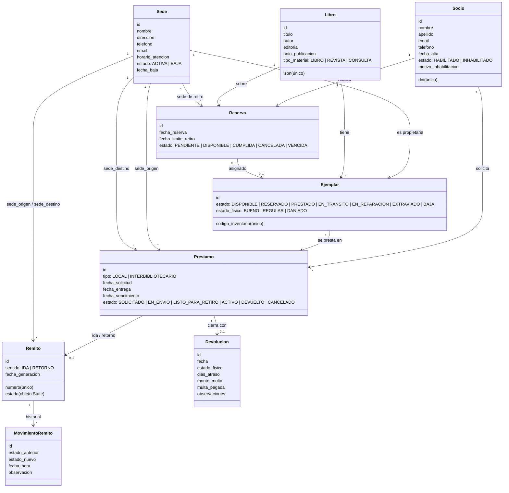

# Modelo de dominio

Este documento describe las entidades del sistema de préstamos interbibliotecarios, sus atributos, sus relaciones y las reglas de negocio que cada una sostiene. Cada decisión de modelado se justifica a partir de la consigna (`docs/consigna.md`) o del funcionamiento habitual de una red de bibliotecas.

## Diagrama de clases

## Entidades

### Sede
Una biblioteca de la red. La consigna pide administrar dirección, datos de contacto, horarios y estado activo/baja.

- La baja es **lógica** (`estado = BAJA` y `fecha_baja`): una sede dada de baja conserva su historial de préstamos y remitos, que los reportes necesitan.
- Una sede en `BAJA` no puede ser origen ni destino de préstamos, reservas ni remitos.

### Socio
Persona habilitada para retirar material.

- El **DNI es único** y es lo que evita socios duplicados.
- La inhabilitación es un cambio de estado con un motivo, no una baja. Un socio `INHABILITADO` no puede recibir préstamos ni hacer reservas.

### Libro (catálogo)
La obra bibliográfica, independiente de cuántas copias físicas haya.

- El **ISBN es único** y es lo que evita duplicados en el catálogo.
- `tipo_material` distingue libros de préstamo común, revistas y material de consulta. La estrategia de multas lo usa para fijar la tarifa.

### Ejemplar
La copia física de un libro. La consigna exige indicar la sede a la que pertenece cada ejemplar.

- El **código de inventario es único** y es lo que evita ejemplares duplicados.
- `sede` es la **sede propietaria**, la que figura en el inventario, y no cambia aunque el ejemplar viaje. Solo se puede prestar un ejemplar cuya sede propietaria sea la sede de origen del préstamo.
- `estado` indica si se puede prestar. Solo un ejemplar `DISPONIBLE` puede asignarse a un préstamo.
- `estado_fisico` se actualiza en cada devolución y en cada recepción de remito.
- Un ejemplar que llega dañado a su sede queda `EN_REPARACION`. La sede decide si lo repara (vuelve a circular con estado físico `REGULAR`) o lo da de baja.

### Prestamo
Una solicitud de préstamo de un ejemplar a un socio.

- **Local:** sede de origen igual a sede de destino. No genera remito y pasa directamente a `ACTIVO`.
- **Interbibliotecario:** el socio retira en la sede de destino un ejemplar que pertenece a la sede de origen. Genera un remito de `IDA` y el préstamo recorre los estados `SOLICITADO → EN_ENVIO → LISTO_PARA_RETIRO → ACTIVO`. Desde la solicitud el ejemplar queda `PRESTADO` (comprometido), para que nadie más lo pida mientras se prepara el envío.
- Una solicitud interbibliotecaria se puede **cancelar** solo mientras está `SOLICITADO`, es decir, antes del despacho. El ejemplar vuelve a quedar disponible.
- No se presta a un socio que tiene **préstamos vencidos sin devolver**. Es la forma de "controlar fechas de vencimiento" en el momento del préstamo, y no solo al devolver.
- El plazo es de **14 días contados desde la entrega al socio** (`fecha_entrega`), no desde la solicitud. Así, el tiempo de traslado entre sedes no le descuenta días al socio. Los 14 días son el valor que usa la cátedra en el ejemplo de biblioteca de la semana 8.
- Un préstamo `ACTIVO` con `fecha_vencimiento` anterior a hoy está **vencido**. Esto es una propiedad calculada, no un estado persistido.

### Remito
El documento que acompaña al ejemplar en cada traslado entre sedes.

- Un préstamo interbibliotecario tiene hasta dos remitos:
  - **`IDA`**: de la sede propietaria a la sede de retiro.
  - **`RETORNO`**: de vuelta a la sede propietaria, después de la devolución.

  El retorno hace falta porque el ejemplar sigue perteneciendo a la sede de origen. Sin un remito de vuelta, el ejemplar quedaría fuera de su sede sin registro del traslado, y la consigna pide trazabilidad "en todo el trayecto".
- El estado se implementa con el patrón **State** (ver `docs/ciclo_de_vida_remito.md`).

### MovimientoRemito
El registro de cada transición de un remito: estado anterior, estado nuevo, fecha y hora, y observación.

- Es lo que hace **trazable** el remito: se puede reconstruir todo el trayecto.
- Con estos registros se calcula el tiempo promedio de tránsito del reporte de movimientos.

### Reserva
El pedido de un socio para retirar un libro que hoy no tiene ejemplares disponibles.

- La reserva es **sobre el libro (título), no sobre un ejemplar puntual**. Así funcionan las reservas en los catálogos de bibliotecas: al socio le sirve cualquier copia de la obra.
- La reserva indica la **sede de retiro**, porque la consigna prohíbe reservas hacia o desde sedes dadas de baja.
- Solo se puede reservar si la sede tiene ejemplares del libro y **ninguno está disponible**. Si hay uno disponible, se presta directamente. Si la sede no tiene ninguno, corresponde un préstamo interbibliotecario.
- Un socio no puede tener dos reservas activas del mismo libro.
- Cuando se devuelve un ejemplar de ese libro en esa sede, se asigna a la **reserva pendiente más antigua** (orden de llegada):
  - El ejemplar pasa a `RESERVADO`.
  - La reserva pasa a `DISPONIBLE`, con un plazo de retiro.
  - El plazo de retiro es de **3 días**.
  - Si el socio no retira el ejemplar dentro del plazo, la reserva pasa a `VENCIDA` y el ejemplar queda libre para la siguiente reserva.
  - Solo el titular de la reserva puede llevarse el ejemplar apartado. Cuando lo retira, la reserva pasa a `CUMPLIDA`.

### Devolucion
El cierre de un préstamo. Registra:

- la fecha de devolución;
- el **estado físico** del material devuelto, como pide la consigna;
- los días de atraso;
- la multa.

La multa es un **monto en pesos** calculado con el patrón **Strategy**. Se eligió un monto, y no días de suspensión, porque la consigna pide un reporte de "multas acumuladas", y lo que se acumula es un importe sumable por socio.

## Reglas de negocio y dónde se validan

| Validación de la consigna | Entidad y regla |
|---|---|
| No prestar ejemplares no disponibles | `Ejemplar.estado` debe ser `DISPONIBLE` (o `RESERVADO` para el socio titular de la reserva) |
| No prestar a socios inhabilitados | `Socio.estado` debe ser `HABILITADO` (también para reservar) |
| Controlar fechas de vencimiento | `Prestamo.fecha_vencimiento` y la propiedad calculada de vencido; no se presta a socios con préstamos vencidos; la multa se calcula en la devolución |
| Mantener trazabilidad del remito | Cada transición del remito registra un `MovimientoRemito` |
| Evitar duplicados | DNI único en `Socio`, ISBN único en `Libro`, código de inventario único en `Ejemplar` |
| No prestar ejemplares de otra sede | La sede propietaria del `Ejemplar` debe ser igual a la `sede_origen` del `Prestamo` |
| No operar con sedes dadas de baja | Las sedes de origen y destino de `Prestamo` y de `Remito`, y la sede de retiro de `Reserva`, deben estar `ACTIVA` |
